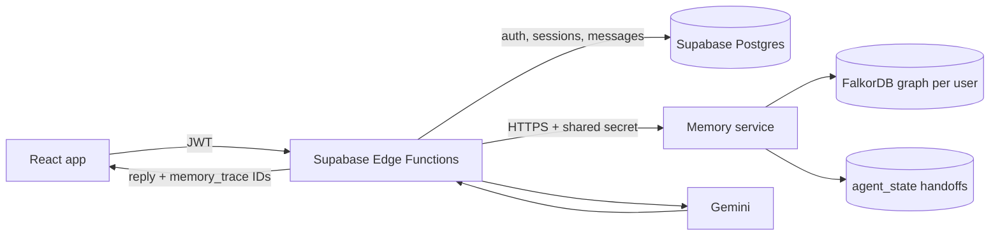

# Core — AI Therapy Companion

A warm, emotionally attuned AI companion for mental wellness conversations. Built with React, Supabase, and ElevenLabs.

## System Architecture

```
┌─────────────────────────────────────────────────────────┐
│                    Frontend (React + Vite)               │
│                                                         │
│  ┌──────────┐  ┌──────────┐  ┌───────────┐             │
│  │ Landing   │  │ Auth     │  │ Onboarding│             │
│  │ Page      │  │ Screen   │  │ Screen    │             │
│  └──────────┘  └──────────┘  └───────────┘             │
│                                                         │
│  ┌──────────────────────────────────────────┐           │
│  │         Chat Screen (Text / Voice)       │           │
│  │  ┌─────────┐  ┌──────────┐  ┌─────────┐ │           │
│  │  │Session  │  │Message   │  │Chat     │ │           │
│  │  │Header   │  │Block     │  │Input    │ │           │
│  │  └─────────┘  └──────────┘  └─────────┘ │           │
│  │  ┌──────────────────────────────┐       │           │
│  │  │ VoiceVisualizer + Mic Button │       │           │
│  │  └──────────────────────────────┘       │           │
│  └──────────────────────────────────────────┘           │
│                                                         │
│  ┌──────────┐  ┌──────────┐  ┌───────────┐             │
│  │ Summary  │  │ History  │  │ Insights  │             │
│  │ Screen   │  │ Screen   │  │ Screen    │             │
│  └──────────┘  └──────────┘  └───────────┘             │
│                                                         │
│  ┌──────────────────────────────────────────┐           │
│  │         Analytics (src/lib/analytics.ts)  │           │
│  │  • Event tracking for all user actions   │           │
│  │  • User properties (user_id, session_id) │           │
│  │  • Ready for Amplitude / Mixpanel / etc  │           │
│  └──────────────────────────────────────────┘           │
└──────────────────┬──────────────────────────────────────┘
                   │
                   ▼
┌─────────────────────────────────────────────────────────┐
│              Supabase (Lovable Cloud)                    │
│                                                         │
│  ┌─────────────────────────────────────────┐            │
│  │           Edge Functions                 │            │
│  │                                         │            │
│  │  /chat          → Streaming LLM (Gemini)│            │
│  │  /end-session   → Summary + Emotions    │            │
│  │  /text-to-speech→ ElevenLabs TTS        │            │
│  │  /speech-to-text→ Whisper STT           │            │
│  └─────────────────────────────────────────┘            │
│                                                         │
│  ┌─────────────────────────────────────────┐            │
│  │           Database (Postgres)            │            │
│  │                                         │            │
│  │  profiles   → user prefs, onboarding    │            │
│  │  sessions   → session metadata, summary │            │
│  │             emotions (JSONB)            │            │
│  │  messages   → full chat logs per session│            │
│  │  memories   → legacy Postgres fallback  │            │
│  │  feedback   → user feedback             │            │
│  └─────────────────────────────────────────┘            │
│                                                         │
│  ┌─────────────────────────────────────────┐            │
│  │           Auth (Email/Password)          │            │
│  └─────────────────────────────────────────┘            │
└─────────────────────────────────────────────────────────┘
                   │
                   ▼
┌─────────────────────────────────────────────────────────┐
│              External APIs                              │
│                                                         │
│  • Lovable AI Gateway (Gemini 2.5 Flash Lite)           │
│    – Chat completions (streaming SSE)                   │
│    – Session summarization & emotion extraction         │
│    – Memory extraction                                  │
│                                                         │
│  • ElevenLabs (eleven_turbo_v2_5)                       │
│    – Text-to-Speech with streaming audio                │
│    – Voice: Laura (FGY2WhTYpPnrIDTdsKH5)               │
│                                                         │
│  • Web Speech API (browser-native)                      │
│    – Speech-to-Text (zero latency, no server round-trip)│
└─────────────────────────────────────────────────────────┘
```

## Data Flow

### Local environment

Create a local `.env` from `.env.example`, then set `VITE_SUPABASE_URL` and
either `VITE_SUPABASE_PUBLISHABLE_KEY` or `VITE_SUPABASE_ANON_KEY` from the
Supabase project's API settings. These are the public browser client values;
never put a service-role key in a `VITE_*` variable. Restart Vite after
changing `.env`.

### Text Mode

1. User types message → `sendMessage()` stores in DB → streams to `/chat` edge function
2. LLM response streamed back via SSE → rendered token-by-token in `MessageBlock`

### Voice Mode

1. User speaks → Web Speech API transcribes in real-time (browser-native, zero latency)
2. Final transcript sent to `/chat` edge function (same as text)
3. Assistant response sent to `/text-to-speech` → ElevenLabs streaming audio
4. After TTS playback ends, auto-listen triggers after 400ms for hands-free conversation

### Session End

1. `/end-session` edge function receives session ID
2. Fetches all messages, generates summary + emotion analysis via LLM
3. In FalkorDB mode, extracts entities, facts, preferences, and goals into the
   user's graph; a Postgres summary remains available as the fallback
4. Returns summary to client → shown on Summary Screen

## Memory architecture (FalkorDB)

Postgres remains the source of truth for authentication, sessions, and messages.
When `MEMORY_BACKEND=falkordb`, the authenticated Supabase edge functions use the
private memory service for graph recall and writes; if recall or write is
unavailable, chat continues with the existing Postgres summary memories.
FalkorDB is never called from the browser, and its URL and the service secret
belong only in the memory-service host and Supabase function secrets.



Each user's memory graph is named `user_<supabase_user_id>` and is never shared
with another account. Its only entities are people and places; topics are
categories on facts, goals, and procedures. Personal facts attach directly to
the user with `HAS_FACT`, facts about a named person or place use `ABOUT`, and
goals attach directly to the user with `HAS_GOAL`. Episodes preserve provenance;
facts and goals link to their source episode, and procedures use
`LEARNED_FROM`. Fact changes retain history with `SUPERSEDES`, while
`RELATED_TO {reason, kind}` connects memories using a stated or tentative
explanation. The shared `agent_state` graph stores user-scoped `Handoff` nodes
with pending or done status. See [docs/MEMORY.md](docs/MEMORY.md) for the schema,
queries, and migration instructions.

The companion agent recalls relevant memories before each chat reply, then
injects a compact “What I remember” block and stores the returned IDs in each
assistant message's `memory_trace`. The memory agent extracts explicit facts,
procedures, and goals after a session summary; changed facts retain history
through `SUPERSEDES` links. The check-in agent consumes a pending handoff on the
next session and displays its personalized opener as that session's first
message. The Memory screen allows a user to inspect and forget individual
memories or delete their whole graph.

### Graph map

Each account has a separate `user_<supabase_user_id>` graph. This is the
semantic and procedural memory model; the full transcript remains in the
user-scoped Supabase `messages` table, while each `Episode` stores a session
summary and its provenance.

```mermaid
graph TD
  User["User (one graph per account)"]
  Episode["Episode (session summary)"]
  Fact["Fact (semantic memory)"]
  Goal["Goal (goal and status)"]
  Procedure["Procedure (learned preference)"]
  Entity["Entity (named person or place)"]
  Handoff["Handoff (shared agent_state graph; user-scoped)"]

  User -->|HAS_FACT| Fact
  User -->|HAS_GOAL| Goal
  User -->|HAS_EPISODE (legacy import)| Episode
  Fact -->|ABOUT| Entity
  Fact -->|DERIVED_FROM| Episode
  Goal -->|DERIVED_FROM| Episode
  Procedure -->|LEARNED_FROM| Episode
  Episode -->|MENTIONS| Entity
  NewFact["New Fact"] -->|SUPERSEDES| OldFact["Older Fact (valid_to set)"]
  Fact -->|RELATED_TO {reason, kind}| Goal
  Episode -. "memory agent writes a user-scoped follow-up" .-> Handoff
  Handoff -. "check-in agent reads and completes" .-> User
```

Memory types map to graph data as follows:

- **Episodic:** `Episode` nodes contain session summaries and connect facts,
  goals, and procedures to their source conversation. The complete conversation
  is retained separately in Supabase.
- **Semantic:** `Fact` and `Goal` nodes represent remembered information and
  goal status. A changed fact is retained as history and linked from its
  replacement with `SUPERSEDES`.
- **Procedural:** `Procedure` nodes store learned preferences or interaction
  guidance and link to the episode that supplied them.

### How the agent queries and updates memory

1. On chat, the authenticated `/chat` Edge Function derives the account ID from
   the user's JWT and asks the private memory service to recall from that
   account's graph.
2. Recall runs graph queries for named entities mentioned in the message,
   relevant active facts about those entities, recent procedures, open goals,
   and recent episodes. If no entity-specific fact matches, it falls back to a
   few recent active facts. These are bounded graph queries, not embedding or
   vector-similarity search.
3. The Edge Function adds the returned memory text to the model context and
   stores the source IDs in the assistant message's `memory_trace`. If graph
   recall is unavailable, it falls back to the user's Postgres summary memories.
4. After session end, the Edge Function saves the session summary and starts
   emotion analysis and memory extraction in the background. The memory agent
   writes an `Episode`, extracted facts, procedures, goals, and stated
   relationships to that user's graph. A changed fact supersedes the old fact.
5. The memory agent creates a user-scoped pending `Handoff` in the shared
   `agent_state` graph. On a later session, the check-in agent reads that user's
   pending handoff, generates a personalized opener from its source memories,
   then marks the handoff complete.

The Edge Function authenticates the user before making service calls; the
memory service is private and requires a shared secret. Per-account graph names
keep graph reads and writes separate, while handoffs are filtered by `user_id`.
The concurrency check below exercises 40 synthetic users in parallel and
verifies that their recalled test facts do not cross accounts. It reports
observed latency percentiles; it is a smoke/load check, not a production
capacity guarantee.

### Production deployment

Vercel hosts the frontend and Supabase hosts authentication, Postgres, and Edge
Functions; neither hosts FalkorDB or the Node.js memory service. Deploy those
as separate services:

1. Create a persistent FalkorDB database and keep its connection URL private.
2. Deploy `memory-service/` to a Node.js 22 host such as Render. Set the service
   root directory to `memory-service`, build with `npm ci && npm run build`,
   and start with `npm start`. Configure `FALKORDB_URL` and a long random
   `MEMORY_SERVICE_SECRET`. The public `/health` endpoint can be used for the
   host's health check; the memory API itself requires the shared secret.
3. In the production Supabase project's Edge Function secrets, set
   `MEMORY_SERVICE_URL` to the service's HTTPS URL and set the same
   `MEMORY_SERVICE_SECRET`. Keep `MEMORY_BACKEND=legacy` until the historic
   memory import below is complete.
4. Apply database migrations and deploy the `chat`, `end-session`, and
   `memory` Edge Functions. Configure any existing AI/provider secrets in
   Supabase as before.
5. From a trusted operator machine, import existing Postgres memory summaries
   using the instructions below. Then set `MEMORY_BACKEND=falkordb` in
   Supabase's function secrets and verify a test account before rolling out.
6. Merge/push the verified frontend code to the Vercel production branch.

Only the memory service needs `FALKORDB_URL`; only the service and Supabase
need `MEMORY_SERVICE_SECRET`. Never put either value or the Supabase
service-role key in Vercel frontend variables or any `VITE_*` setting.

### Import existing Postgres memories before enabling graph recall

Existing rows in the Supabase `memories` table are not automatically converted
when FalkorDB is enabled. Before switching production to
`MEMORY_BACKEND=falkordb`, run this idempotent import from a trusted operator
environment with `SUPABASE_URL`, `SUPABASE_SERVICE_ROLE_KEY`,
`MEMORY_SERVICE_URL`, and `MEMORY_SERVICE_SECRET` configured:

```sh
npm run migrate:legacy-memories
```

The script imports each account's legacy memory summaries as dated `Episode`
nodes in that account's graph. It does not send transcripts, infer facts from
summary prose, delete Postgres data, or create follow-up handoffs. Rerun it to
catch summaries written while the import was running. Keep the service-role
key only in the trusted operator environment; never expose it in a `VITE_*`
variable or frontend code.

## Key Design Decisions

- **Gemini 2.5 Flash Lite** for chat: fastest + cheapest model, ideal for short therapeutic responses
- **Streaming SSE** for chat: tokens appear as they're generated, reducing perceived latency
- **Browser-native STT**: eliminates server round-trip for speech recognition
- **ElevenLabs Turbo v2.5**: optimized for low-latency streaming TTS
- **2-sentence max responses**: enforced via system prompt + `max_tokens: 100`
- **Memory system**: FalkorDB graph recall with source traces, superseding facts,
  per-user isolation, and a legacy Postgres fallback

## Tech Stack

- **Frontend**: React 18, Vite, TypeScript, Tailwind CSS, Framer Motion, shadcn/ui
- **Backend**: Supabase (Lovable Cloud) — Postgres, Auth, Edge Functions (Deno)
- **AI**: Lovable AI Gateway (Gemini), ElevenLabs TTS
- **Voice**: Web Speech API (STT), ElevenLabs (TTS)

## Development

```sh
npm i
npm run dev
```

## CI and release checks

Pull requests run formatting, ESLint, TypeScript, unit tests, mocked chat API
integration tests, and a production build in that order. The
required GitHub check is **CI / Lint, types, tests, and build**.
The Prettier check currently gates the manifest, workflow, script, and test
files; ESLint covers the application source. Existing source files have
Prettier baseline differences, so expanding Prettier enforcement to all source
files should be paired with a separate formatting-only change.

To make those checks mandatory, a repository admin must add a branch protection
rule or ruleset for `main` in **Settings → Branches**. Require a pull request
before merging, require the check above to pass, and prevent force pushes and
branch deletions. Disable administrator bypass if direct pushes must be blocked
for administrators too.

For post-deploy checks, run **Actions → Staging smoke tests → Run workflow**
after deploying a preview/staging version. Configure the following GitHub
Actions secrets first:

- `STAGING_SUPABASE_URL`
- `STAGING_SUPABASE_ANON_KEY`
- Optional `STAGING_SMOKE_AUDIO_BASE64` to exercise speech-to-text as part of
  the voice round trip

The smoke workflow exercises the real staging chat and text-to-speech
providers; configure their provider secrets in the staging Supabase project.
Without the audio fixture, speech-to-text is skipped. Keep staging separate
from production. With Vercel Git deployments, use a preview deployment as
staging, run the smoke workflow, and promote that exact verified deployment
only after it succeeds:

```sh
npx vercel promote <verified-deployment-url>
```

For rollback to the previous production deployment:

```sh
npx vercel rollback
```

These commands require an authenticated Vercel CLI linked to the project. If
production currently auto-deploys on a `main` push, configure Vercel so that
the production promotion cannot bypass staging smoke tests. Production
credentials must stay in the hosting provider, not in this repository.
